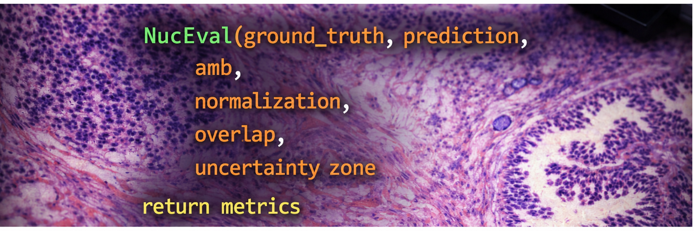
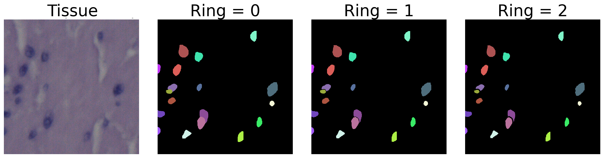

<p align="center">
  
</p>

<h1 align="center">NucEval: Revisiting and Extending Evaluation Metrics for Nuclear Instance Segmentation</h1>


<p align="center">
  <a href="#requirements">Requirements</a> •
  <a href="#quick-start">Quick Start</a> •
  <a href="#features">Features</a> •
  <a href="#interface">Interface</a> •
  <a href="#examples">Examples</a> •
  <a href="#datasets">Datasets</a> •
  <a href="#citation">Citation</a> •
  <a href="#references">References</a>
</p>

---

## Why NucEval?

Standard nuclei segmentation evaluation has several known issues that can lead to unfair or inaccurate metric scores:

| Problem | Impact | NucEval Solution |
|---------|--------|------------------|
| **Ambiguous regions** | Annotators identify uncertain regions; however, evaluation metrics still penalize or reward predictions within these areas. | Instances that partially overlap with vague zones, as determined by a predefined threshold, are excluded prior to scoring. |
| **Overlapping annotations** | ROI-based GT allows overlapping nuclei, but label maps force one label per pixel — losing boundary information | Accepts ROI files or list of binary masks (one instance per mask)|
| **Score normalization** | Simple averaging treats images with 3 nuclei the same as images with 300 | Optional nuclei-weighted averaging across images of a dataset |
| **Border uncertainty** | Exact nucleus boundaries are inherently uncertain by a few pixels | Boundary zone masks out uncertain pixels from both GT and prediction |

NucEval wraps all of these into **a single function call** with sensible defaults — so the simplest call gives you standard evaluation, and each feature can be enabled independently.

---

## Requirements

```bash
pip install numpy scipy opencv-python
```

Then copy `nuceval.py` into your project. That's it! single file, no build step.

**Dependencies:** NumPy, SciPy, OpenCV (cv2)

For `evaluate_dataset.py` and the examples, you also need:

```bash
pip install pandas tifffile tqdm
```

---

## Quick Start

```python
from nuceval import NucEval

# Standard evaluation — identical to traditional metrics
result = NucEval(gt_label_map, pred_label_map)
print(result)
# {'dice': 0.92, 'aji': 0.85, 'dq': 0.90, 'sq': 0.88, 'pq': 0.79}
```

That's all you need for basic usage. Every other feature is opt-in.

---

## Features

### 1. Ambiguous region handling

Exclude nuclei that overlap with annotator-flagged uncertain regions:

```python
result = NucEval(gt, pred, amb=amb_mask)

# Custom overlap threshold (default: 0.25)
result = NucEval(gt, pred, amb=amb_mask, overlap_thresh_amb=0.5)
```

An instance is removed (from both prediction and GT) if more than `overlap_thresh_amb` fraction of its area falls in the ambiguous zone.


### 2. Score normalization

Enable nuclei-weighted averaging across images of a dataset:

```python
result = NucEval(gt, pred, normalized=True)
# result now includes 'num_nuclei': 24
```

Use `num_nuclei` to compute weighted means, so images with more nuclei contribute proportionally more to the dataset score. For images without GT nuclei, `num_nuclei` equals the number of predicted instances, so false positives on such images still lower the weighted score.

### 3. Handling overlapping instances (with flexible GT formats)

NucEval auto-detects the ground truth format:

```python
# Label map (numpy array, 0 = background)
result = NucEval(gt_label_map, pred)

# ROI directory (ImageJ/FIJI .roi files — handles overlapping instances)
result = NucEval("path/to/roiset/", pred)

# List of binary masks (from any source)
result = NucEval([mask1, mask2, mask3], pred)
```
Examples of accepted annotation formats for an image can be found in the [examples](./examples) folder.

### 4. Boundary uncertainty zone

Account for annotation uncertainty at nucleus borders:

```python
result = NucEval(gt, pred, zone_width=1) #(0 = disabled)
```

For each GT instance, the mask is eroded and dilated by `zone_width` pixels. The zone (ring) between the eroded core and the dilated boundary is masked out from **both** GT and prediction before scoring. This prevents penalizing predictions for disagreeing with GT in the inherently uncertain boundary zone.

<p align="center">
  
</p>


### Others: configurable PQ matching and selective metrics:

Adjust the IoU threshold for instance matching (this threshold is part of PQ implementation [1]):

```python
# Configurable IoU matching (default Standard)
result = NucEval(gt, pred, match_iou=0.5) #(default: 0.5)


# Compute only what you need (selective metrics):

# Only Dice and PQ
result = NucEval(gt, pred, metrics=["dice", "pq"])
# {'dice': 0.92, 'pq': 0.79}

# Only instance-level metrics
result = NucEval(gt, pred, metrics=["aji", "dq", "sq", "pq"])
```

---

## Interface

```python
NucEval(ground_truth, prediction,  # both with size of (H,W)
        amb=None,                  # Ambiguous mask (H,W), non-zero = ambiguous
        normalized=False,          # Include num_nuclei in output
        zone_width=0,              # Boundary zone width in pixels (0 = disabled)
        overlap_thresh_amb=0.25,   # Fraction threshold for ambiguous removal
        match_iou=0.5,             # IoU threshold for PQ matching
        metrics=None)              # List of metrics, or None for all
```

**Parameters:**

| Parameter | Default | Description |
|-----------|---------|-------------|
| `ground_truth`       | *required*   | Label map, list of binary masks, or path to ROI directory |
| `prediction`         |  *required*  | Instance label map (H,W), 0 = background |
| `amb`                | `None`       | Ambiguous region mask |
| `normalized`         |  `False`     | If True, include `num_nuclei` in output |
| `zone_width`         |  `0`         | Boundary zone width (0 = no zone; 1 pixel was used in the paper) |
| `overlap_thresh_amb` |  `0.25`      | Ambiguous overlap threshold |
| `match_iou`          |  `0.5`       | PQ matching IoU threshold |
| `metrics`            |  `None`      | Subset of `["dice", "aji", "dq", "sq", "pq"]` |

**Returns:** `dict` with requested metric scores.

---

## Examples

### Single image evaluation

```python
import os
import cv2
import numpy as np
import tifffile
from nuceval import NucEval


gt = tifffile.imread("./examples/GT/human_bladder_01.tif") # case 1
####################################################################
gt = "./examples/GT/human_bladder_01_roiset" # case 2
####################################################################
gt_dir = r"./examples/GT/human_bladder_01_png_masks" # case 3
gt = [cv2.imread(os.path.join(gt_dir, f), cv2.IMREAD_GRAYSCALE) // 255
          for f in sorted(os.listdir(gt_dir)) if f.endswith('.png')]
####################################################################
pred = np.load("./examples/Prediction/human_bladder_01.npy") #example with .npy format (could be also .tif)
amb_mask = cv2.imread("./examples/amb_masks/human_bladder_01.png", cv2.IMREAD_GRAYSCALE)

# All features enabled
result = NucEval(gt, pred,
                 amb=amb_mask,
                 normalized=True,
                 zone_width=2,
                 overlap_thresh_amb=0.25,
                 match_iou=0.5)

print(f"Dice: {result['dice']:.4f}")
print(f"PQ:   {result['pq']:.4f}")
print(f"Nuclei: {result['num_nuclei']}")

# Case 1:  Dice: 0.8833, PQ:   0.6742, Nuclei: 19
# Case 2:  Dice: 0.8883, PQ:   0.6787, Nuclei: 19
# Case 3:  Dice: 0.8883, PQ:   0.6787, Nuclei: 19

```

### Dataset evaluation with CSV output

Run `evaluate_dataset.py` from the repository root. By default it evaluates the two example images in the [examples](./examples) folder and saves the per-image results, the simple mean and the nuclei-weighted mean to `metrics_results.csv`. Change the paths at the top of the script to evaluate your own dataset.

### Synthetic example

The [examples/synthetic](./examples/synthetic) folder contains a small synthetic image with four circular instances. Each instance isolates the effect of one modification, as described in the paper:

| Instance | Setup | Modification shown |
|----------|-------|--------------------|
| 1 | Lies fully within an ambiguous region; GT and prediction do not overlap | #1 (ambiguous regions) |
| 2 and 3 | Overlap; the shared region is assigned to opposite instances in GT and prediction | #3 (overlapping instances) |
| 4 | Small circle whose prediction differs from the GT by a one-pixel boundary | #4 (border uncertainty) |

Modification #2 (score normalization) is not included, as it is an aggregation step across images and does not apply to a single image.

The folder contains the merged GT label map (`gt_labelmap.tif`), the overlap-preserving GT as one binary mask per instance (`Overlap-preserving GT/inst_*.tif`), the prediction (`pred_labelmap.tif`) and the ambiguous mask (`amb_mask.png`).

Run it from the repository root:

```bash
python examples/synthetic/run_synthetic_eval.py
```

Expected output (values in %, as reported in the paper):

```
Using MERGED label-map GT (cannot show Mod #3 — overlaps are merged)
Baseline                         PQ= 63.33  AJI= 71.41  Dice= 91.53  DQ= 75.00  SQ= 84.45
Modification #1 (vague)          PQ= 84.45  AJI= 83.08  Dice= 99.70  DQ=100.00  SQ= 84.45
Modification #4 (boundary)       PQ= 66.55  AJI= 72.04  Dice= 91.85  DQ= 75.00  SQ= 88.74

Using OVERLAP-PRESERVING GT (list of masks) — enables Mod #3
Baseline + Modification #3       PQ= 67.62  AJI= 78.44  Dice= 91.53  DQ= 75.00  SQ= 90.16
Modification #1 + #3             PQ= 90.16  AJI= 91.26  Dice= 99.70  DQ=100.00  SQ= 90.16
Modification #1 + #3 + #4        PQ= 94.61  AJI= 92.25  Dice=100.00  DQ=100.00  SQ= 94.61
```

Even with all applicable modifications, PQ, AJI and SQ do not reach 100%. This is expected: the prediction assigns the overlapping region to a single instance, which is a genuine difference from the overlap-preserving GT rather than an evaluation artifact.

---

## Datasets

We used four public datasets in this study. For NuInsSeg, CryoNuSeg and PCNS, please download the data from the original publications:

| Dataset | Description | Reference |
|---------|-------------|-----------|
| **NuInsSeg** | H&E images from 31 human and mouse organs, with ambiguous region masks and ImageJ ROI files (overlap-preserving) | Mahbod et al., *Scientific Data*, 2024. [doi:10.1038/s41597-024-03117-2](https://doi.org/10.1038/s41597-024-03117-2) |
| **CryoNuSeg** | 30 cryosectioned H&E images from 10 human organs, annotated by multiple annotators | Mahbod et al., *Computers in Biology and Medicine*, 2021. [doi:10.1016/j.compbiomed.2021.104349](https://doi.org/10.1016/j.compbiomed.2021.104349) |
| **PCNS** | 1,356 H&E images (256x256) from ten cancer types | Hou et al., *Scientific Data*, 2020. [doi:10.1038/s41597-020-0528-1](https://doi.org/10.1038/s41597-020-0528-1) |
| **MoNuSAC** | Multi-organ nuclei segmentation and classification challenge data | Verma et al., *IEEE Transactions on Medical Imaging*, 2021. [doi:10.1109/TMI.2021.3085712](https://doi.org/10.1109/TMI.2021.3085712) |

### Revised MoNuSAC test data

For the ranking experiment in the paper, we converted the MoNuSAC test set into class-agnostic instance label maps (all nucleus classes merged) with the corresponding ambiguous region masks. The revised data are available here:

[Google Drive: revised MoNuSAC test data](https://drive.google.com/drive/folders/1UvXm-1I8g7zqEdxqd0-xfdIn6LG0Z-mL?usp=sharing)

If you use these data, please also cite the original MoNuSAC publication (Verma et al., 2021).

---
## Metrics
The core implementation is adapted from [1].
| Metric | What it measures | Range |
|--------|-----------------|-------|
| **Dice** | Pixel-level overlap (binary foreground) | 0-1 |
| **AJI**  | Aggregated Jaccard Index  | 0–1 |
| **DQ**   | Detection Quality - F1 score of instance matching | 0–1 |
| **SQ**   | Segmentation Quality - mean IoU of matched pairs | 0–1 |
| **PQ**   | Panoptic Quality = DQ × SQ | 0–1 |

---

## Models
We evaluated NucEval using predictions obtained from three trained models: Hover-Net [2], Hover-Next [3], and CellViT [4].  
The implementations are available in the original publications. The 5-fold cross-validation used in this study for each model is also available in the [hover-net](./models_main/Models/hover_net) (`run_hovernetFolds.py`), [hover-next](./models_main/Models/HoverNext) (`run_hovernextFolds.py`), and [CellViT](./models_main/Models/CellVit/cell_segmentation) (`run_cellvit_folds.py`) folders.


---

## Citation
Preprint on arXiv: https://arxiv.org/abs/2605.03144

If you use NucEval in your research, please cite the following:

```bibtex
@misc{mahbod2026nucevalrobustevaluationframework,
      title={NucEval: A Robust Evaluation Framework for Nuclear Instance Segmentation}, 
      author={Amirreza Mahbod and Ramona Woitek and Jeanne Shen},
      year={2026},
      eprint={2605.03144},
      archivePrefix={arXiv},
      primaryClass={cs.CV},
      url={https://arxiv.org/abs/2605.03144}, 
}
```

---

## References
[1] https://github.com/vqdang/hover_net  
[2] Graham S, Vu QD, Raza SE, Azam A, Tsang YW, Kwak JT, Rajpoot N. Hover-net: Simultaneous segmentation and classification of nuclei in multi-tissue histology images. Medical image analysis. 2019 Dec 1;58:101563.  
[3] Baumann E, Dislich B, Rumberger JL, Nagtegaal ID, Martinez MR, Zlobec I. Hover-next: A fast nuclei segmentation and classification pipeline for next generation histopathology. InMedical Imaging with Deep Learning 2024 Dec 23.  
[4] Hörst F, Rempe M, Heine L, Seibold C, Keyl J, Baldini G, Ugurel S, Siveke J, Grünwald B, Egger J, Kleesiek J. Cellvit: Vision transformers for precise cell segmentation and classification. Medical image analysis. 2024 May 1;94:103143.  


## License

The NucEval code (`nuceval.py`, `evaluate_dataset.py`, `examples/`) is released under the [MIT License](LICENSE).
The model code in `models_main/` is adapted from HoVer-Net, HoVer-NeXt and CellViT and remains under the licenses of the original repositories (see the LICENSE file in each model folder).
